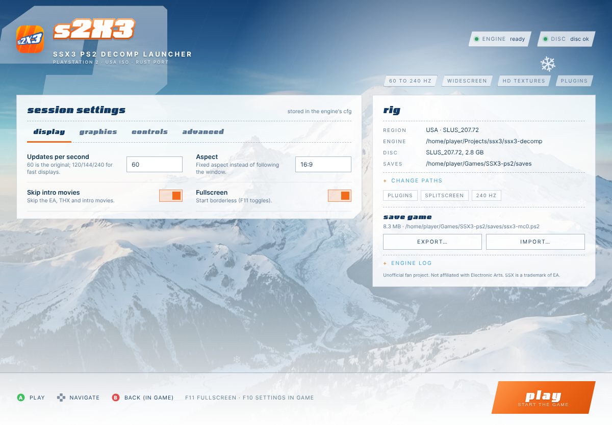

<p align="center">
  
</p>

<h1 align="center">s2X3</h1>

<p align="center">
  <strong>A clean launcher and installer for the native SSX 3 port on PlayStation 2.</strong><br>
  Your disc, your settings, one place.
</p>

<p align="center">
  <a href="LICENSE"></a>
  <a href="https://github.com/bitm4ncer/s2x3/releases/latest"></a>
  <a href="https://github.com/bitm4ncer/s2x3/releases/latest"></a>
  <a href="https://github.com/bitm4ncer/s2x3/releases/latest"></a>
  <a href="https://github.com/bitm4ncer/s2x3/releases/latest"></a>
  <a href="https://github.com/andersfischernielsen/ssx3-decomp"></a>
</p>

> **You need your own SSX 3 PS2 USA ISO.** s2X3 ships no game data and no ISO.
> Use a legally owned copy of the game. [Search DuckDuckGo](https://duckduckgo.com/?q=SSX+3+USA+PS2+ISO)
> for the USA disc image (`SLUS_207.72`).

---

s2X3 is a desktop launcher for [ssx3-decomp](https://github.com/andersfischernielsen/ssx3-decomp),
the native Rust port of SSX 3 for PlayStation 2. It detects your installation,
edits the engine settings through a schema, starts the engine as a child
process and keeps paths, saves and logs in one place.

It is not an emulator, not a recompiler and not a game distribution. It ships
no engine code and no game data. You bring your own USA disc image.



[**Website and screenshots →**](https://bitm4ncer.github.io/s2x3/)

## Features

- **Disc detection**: finds the USA disc image (`SLUS_207.72`) and verifies it before launch.
- **Settings that stay**: every engine option is generated from a schema, written to the engine config and merged with changes made in the in game overlay (F10).
- **One click play**: starts the native port fullscreen, with Xbox button prompts, 16:9 and 60 to 240 Hz support.
- **Saves**: export and import the PS2 memory card with timestamped backups.
- **Engine setup**: download and build `ssx3-decomp` from the app, plus an update check when the repository moves forward.
- **Trick spin controls**: cross pad, left stick or right stick, with air gating so acceleration never triggers a flip by accident.
- **Logs**: engine output and build output are available inside the app.
- **No game data**: no ISO, no extracted assets and no generated code in the repository.

## Requirements

- Linux is the daily-driver. Windows alpha installers are published in [Releases](https://github.com/bitm4ncer/s2x3/releases/latest); macOS is planned. The engine itself builds on all three.
- Your own **USA** disc image of SSX 3 for PlayStation 2 (`SLUS_207.72`).
- Rust and Python 3 to build the engine locally, Vulkan drivers to run it.
- A Vulkan capable GPU. Intel Iris Xe runs it at 60 fps with the heavy effects off.

## Quick start

Build the CLI and the desktop app:

```sh
git clone https://github.com/bitm4ncer/s2x3.git
cd s2x3
cargo build --release
./target/release/s2x3 detect
```

```sh
cd apps/desktop
npm install
npm run tauri dev
```

The app can download and build the engine for you. To do it by hand:

```sh
git clone https://github.com/andersfischernielsen/ssx3-decomp.git ~/Projects/ssx3/ssx3-decomp
cd ~/Projects/ssx3/ssx3-decomp
SSX3_ISO="/path/to/SSX 3 (USA).iso" python3 tools/setup.py
cargo build --profile game -p ssx3
```

Point s2X3 at the engine folder and the ISO in **Change paths**, then press
**play**.

## Status

Alpha, used daily on Linux. The launcher, settings, saves and engine setup
work. See [ROADMAP.md](ROADMAP.md) for the phases and [AGENTS.md](AGENTS.md)
for the split between launcher work and upstream engine fixes.

Planned:

- menus and intro video fill for 4:3 front end screens
- performance presets for integrated GPUs
- Tricky courses as plugins
- Tricky audio dub
- web companion, no game code hosted
- LAN and online multiplayer later

## Legal

SSX is a trademark of Electronic Arts. s2X3 is an unofficial fan project,
not affiliated with or endorsed by EA. You need your own copy of the game. The
repository contains no game data, no ISO, no extracted textures and no
recompiled game code. Controller glyphs are original inline SVG; no third-party
button art is bundled. The display face, Tomorrow (SIL OFL 1.1), is bundled
with the source.

## License

[GPL-3.0-or-later](LICENSE). The engine is MIT licensed by its authors. Keep
the engine notices when you redistribute it.

## Credits

- [ssx3-decomp](https://github.com/andersfischernielsen/ssx3-decomp) by [Anders Fischer Nielsen](https://github.com/andersfischernielsen), MIT.
- [Tauri](https://tauri.app) for the desktop shell.
- [Tomorrow](https://fonts.google.com/specimen/Tomorrow) display face by the Tomorrow Project Authors, SIL OFL 1.1.
- [Silkscreen](https://fonts.google.com/specimen/Silkscreen) pixel face by Jason Kottke, SIL OFL 1.1.
- The SSX 3 community for testing, saves and feedback.
